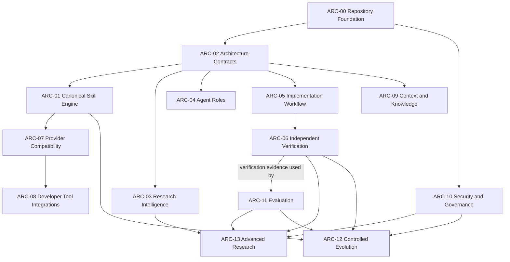

# ARC Dependency Map

This is a proposed architecture baseline. Priorities, ownership and acceptance criteria are recommendations for team review. Every ARC is **PLANNED** because no implementation evidence was found on the audited `yousuf` branch. A planned document is not implementation evidence.

## Dependency overview

Arrows mean “depends on.” They indicate proposed sequencing, not a claim that all dependencies require a runtime link. ARC-10 is a cross-cutting gate: security boundaries should be specified before modules handle sensitive data or perform consequential actions.

## Status and lifecycle

Initial status for all entries: **PLANNED**. Use `SPECIFIED` when scope and contracts are reviewed; `IMPLEMENTED` only with implementation evidence; `EVALUATED` only with recorded evaluation evidence; `APPROVED` only after a named approval; `BLOCKED` with a recorded blocker; and `DEPRECATED` with a replacement or retirement rationale. These states must not be inferred from file or directory presence.

## ARC register

### ARC-00 — Repository Foundation and Safety

- **Purpose / non-goals:** Establish repository integrity, contribution, review and safe-change conventions. Does not prescribe an application runtime.
- **Dependencies:** None.
- **Owner:** Member 1.
- **Priority / status:** P0 / PLANNED.
- **Proposed deliverables:** Contribution guidance, repository safety rules, branch/PR workflow, validation entry point.
- **Acceptance:** Rules identify ownership, review, preservation of user work, and authorized handling of consequential operations; team approves the baseline.
- **Evidence:** Git repository exists; no such policy was found on audited `yousuf`.
- **Risks / decisions:** Integration base is unresolved; choose branch policy and required review count.

### ARC-01 — Canonical Skill Engine

- **Purpose / non-goals:** Define, validate, version and discover reusable Skills from one canonical source. Does not create provider-maintained behavioral forks.
- **Dependencies:** ARC-00, ARC-02.
- **Owner:** Member 3.
- **Priority / status:** P0 / PLANNED.
- **Proposed deliverables:** Skill contract, canonical catalog, validation rules and lifecycle guidance.
- **Acceptance:** A representative Skill has one authoritative source, passes agreed validation, and exposes documented inputs, outputs and limits.
- **Evidence:** No Skills or registry found.
- **Risks / decisions:** Choose format, metadata, versioning and validation mechanism.

### ARC-02 — Architecture and Module Contracts

- **Purpose / non-goals:** Define boundaries, dependencies, ownership, contracts and architecture decisions. Does not implement module behavior.
- **Dependencies:** ARC-00.
- **Owner:** Member 1.
- **Priority / status:** P0 / PLANNED.
- **Proposed deliverables:** ARC register, dependency map, contract template, decision records.
- **Acceptance:** Each active proposal records purpose, non-goals, interfaces, dependencies, accountable owner, security, failures, tests, measurable acceptance, status and evidence.
- **Evidence:** No architecture artifacts were found before this baseline.
- **Risks / decisions:** Team review is required; avoid presenting this proposal as an approved architecture.

### ARC-03 — Research Intelligence

- **Purpose / non-goals:** Support sourced research, provenance and evidence quality. Does not treat generated summaries as verified facts.
- **Dependencies:** Hard: ARC-02. Optional: ARC-09 may provide knowledge/provenance services if requirements need them. Conditional review: ARC-10 when its gate conditions are met.
- **Owner:** Member 2.
- **Priority / status:** P1 / PLANNED.
- **Proposed deliverables:** Research workflow, source-quality criteria, claim/evidence records.
- **Acceptance:** Sample research records distinguish source, claim, inference, uncertainty and date; reviewer can trace material claims to sources.
- **Evidence:** No research workflow or evidence records found.
- **Risks / decisions:** Define source handling, retention, licensing and recency expectations.

### ARC-04 — Agent Roles and Delegation

- **Purpose / non-goals:** Define role responsibilities, handoffs and delegation limits. Does not grant implicit tool permissions.
- **Dependencies:** Hard: ARC-02. Conditional review: ARC-10 when its gate conditions are met.
- **Owner:** Member 1. Member 3 may contribute implementation Skills; Member 2 may review evaluation needs.
- **Priority / status:** P1 / PLANNED.
- **Proposed deliverables:** Role contracts, handoff format, delegation boundaries.
- **Acceptance:** Each role has accountable scope, inputs/outputs, escalation conditions and permission limits; handoffs preserve evidence and status.
- **Evidence:** No role definitions found.
- **Risks / decisions:** Agree whether role contracts are provider-neutral data or canonical Skills.

### ARC-05 — Implementation, TDD and Debugging

- **Purpose / non-goals:** Provide scoped implementation, test-first and debugging workflows. Does not claim correctness without executed checks.
- **Dependencies:** Hard: ARC-01, ARC-02. Conditional review: ARC-10 when its gate conditions are met.
- **Owner:** Member 3.
- **Priority / status:** P1 / PLANNED.
- **Proposed deliverables:** Implementation workflow Skill and evidence-based completion format.
- **Acceptance:** A sample task includes explicit scope and criteria, preserves unrelated work, records actual commands, and reports failures honestly.
- **Evidence:** No code, tests or workflow found.
- **Risks / decisions:** Align with selected repository toolchain and authorization rules.

### ARC-06 — Independent Verification

- **Purpose / non-goals:** Independently verify acceptance claims and record reproducible evidence. Does not replace implementation ownership or approval authority.
- **Dependencies:** Hard: ARC-02, ARC-05. No dependency on ARC-11; ARC-11 may use ARC-06 verification evidence.
- **Owner:** Member 2.
- **Priority / status:** P1 / PLANNED.
- **Proposed deliverables:** Verification protocol, evidence report template, independence criteria.
- **Acceptance:** A verifier other than the implementer reproduces agreed checks and records commands, outcomes, limitations and unresolved failures.
- **Evidence:** No verification process found.
- **Risks / decisions:** Define acceptable independence and approval authority.

### ARC-07 — Multi-Provider Compatibility

- **Purpose / non-goals:** Adapt canonical contracts to provider capabilities while preserving one canonical Skill source. Does not maintain divergent copies.
- **Dependencies:** Hard: ARC-01 (canonical Skill contract), ARC-02 (architecture boundaries). ARC-04 is an optional integration if a concrete role use case justifies it.
- **Owner:** Member 3.
- **Priority / status:** P1 / PLANNED.
- **Proposed deliverables:** Provider capability matrix, adapter contract, compatibility cases.
- **Acceptance:** Each adapter maps to a canonical version; compatibility tests identify unsupported behavior and do not silently change semantics.
- **Evidence:** No adapters or provider docs found.
- **Risks / decisions:** Choose initial providers and compatibility guarantees.

### ARC-08 — Developer-Tool Integrations

- **Purpose / non-goals:** Connect approved developer tools through documented, least-privilege interfaces. Does not assume access to accounts or repositories.
- **Dependencies:** Hard: ARC-02, ARC-07. Conditional review: ARC-10 because integrations involve external access.
- **Owner:** Member 3.
- **Priority / status:** P2 / PLANNED.
- **Proposed deliverables:** Integration boundary docs, permission matrix, failure and revocation behavior.
- **Acceptance:** Each selected integration documents data access, authorization, credential handling, failure modes and test evidence.
- **Evidence:** No integrations found.
- **Risks / decisions:** Select tools and data-handling constraints before implementation.

### ARC-09 — Context, Memory and Knowledge Fabric

- **Purpose / non-goals:** Govern context, memory and knowledge provenance, retrieval and retention. Does not imply unrestricted or permanent memory.
- **Dependencies:** Hard: ARC-02. Conditional review: ARC-10 when sensitive data or access controls are involved.
- **Owner:** Member 1. Member 3 may contribute an implementation proposal.
- **Priority / status:** P2 / PLANNED.
- **Proposed deliverables:** Data model, provenance rules, access/retention policy, retrieval evaluation.
- **Acceptance:** Stored knowledge has source, scope, access and retention rules; retrieval quality and deletion behavior are measurable.
- **Evidence:** No memory or knowledge artifacts found.
- **Risks / decisions:** Define sensitive-data classes, retention and user control.

### ARC-10 — Security, Safety and Governance

- **Purpose / non-goals:** Define threat review, permissions, safety gates and governance evidence. Does not certify a system safe solely by policy.
- **Dependencies:** ARC-00, ARC-02.
- **Owner:** Member 1. Member 2 may coordinate verification evidence.
- **Priority / status:** P0 / PLANNED.
- **Proposed deliverables:** Threat-review template, permission model, security test criteria, exception process.
- **Acceptance:** Initial modules document trust boundaries, data access, failure/abuse cases, mitigations and review evidence.
- **Evidence:** No security or governance policy found.
- **Risks / decisions:** Agree threat scope, review gates and escalation/approval authority.

### ARC-11 — Evaluation and Benchmarking

- **Purpose / non-goals:** Measure defined behaviors using reproducible scenarios and metrics. Does not equate benchmark performance with general capability.
- **Dependencies:** ARC-02, ARC-06 for independent verification of evaluation claims.
- **Owner:** Member 2.
- **Priority / status:** P1 / PLANNED.
- **Proposed deliverables:** Evaluation scenarios, metric definitions, result format and regression policy.
- **Acceptance:** Results record version, inputs, method, metrics, limitations and reproducible evidence; claims stay within measured scope.
- **Evidence:** No benchmarks or evaluation assets found.
- **Risks / decisions:** Choose evaluation thresholds and handling of nondeterministic results.

### ARC-12 — Controlled Continuous Evolution

- **Purpose / non-goals:** Govern versioning, updates, regressions and retirement. Does not permit silent self-modification or unreviewed releases.
- **Dependencies:** Hard: ARC-00, ARC-01, ARC-06, ARC-11. Conditional review: ARC-10 for changes meeting its gate conditions.
- **Owner:** Member 1.
- **Priority / status:** P2 / PLANNED.
- **Proposed deliverables:** Change lifecycle, compatibility policy, rollback and deprecation rules.
- **Acceptance:** Every release/change has traceable diff, evaluation evidence, reviewer/approver and rollback or retirement path.
- **Evidence:** No evolution process found.
- **Risks / decisions:** Define release authority, cadence and compatibility guarantees.

### ARC-13 — Advanced AGI Research Modules

- **Purpose / non-goals:** Isolate advanced research experiments with explicit limits. Does not present hypotheses or benchmark results as demonstrated general AGI capability.
- **Dependencies:** ARC-03, ARC-06, ARC-10, ARC-11.
- **Owner:** Member 2. Member 1 contributes architecture boundary review.
- **Priority / status:** P2 / PLANNED.
- **Proposed deliverables:** Experiment protocol, risk review, reproducibility package and claim taxonomy.
- **Acceptance:** Each experiment states hypothesis, scope, safeguards, method, results, limitations and independent reproduction status; capability claims match evidence.
- **Evidence:** No research modules or experiments found.
- **Risks / decisions:** Define review threshold and permitted experiment scope before work starts.
