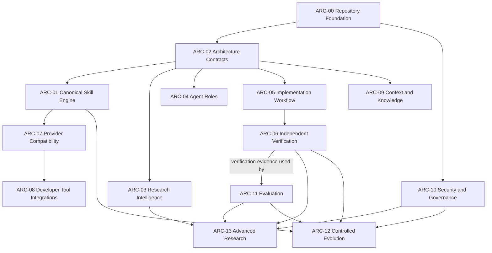

# ARC Dependency Map

This is a proposed architecture baseline. Member 1/2/3 labels and file assignments refer to the earlier proposed collaboration model and are not current assignments. Historical evidence notes originated from an audit of the `yousuf` branch and are not a current repository inventory. This map records a bounded reconciliation against the current `main` checkout on 2026-10-29; it does not accept every contract, establish independent evaluation, or authorize gated actions. See the [M2 prerequisite status](./m2-prerequisite-status.md) for current evidence and remaining decisions.

## Dependency overview

Arrows mean “depends on.” They indicate proposed sequencing, not a claim that all dependencies require a runtime link. ARC-10 is a cross-cutting gate: security boundaries should be specified before modules handle sensitive data or perform consequential actions.

## Status and lifecycle

Use `PLANNED` when an item is not yet specified; `SPECIFIED` when its scope and contract have been reviewed; `PARTIAL` when only a bounded subset of acceptance is implemented; `IMPLEMENTED` only when the stated acceptance criteria have implementation evidence; `EVALUATED` only with recorded evaluation evidence; `APPROVED` only after a named approval; `BLOCKED` with a recorded blocker; and `DEPRECATED` with a replacement or retirement rationale. These states must not be inferred from file or directory presence. `SPECIFIED`, `PARTIAL`, and `IMPLEMENTED` do not mean approved.

## ARC register

### ARC-00 — Repository Foundation and Safety

- **Purpose / non-goals:** Establish repository integrity, contribution, review and safe-change conventions. Does not prescribe an application runtime.
- **Dependencies:** None.
- **Owner:** Member 1.
- **Priority / status:** P0 / PLANNED.
- **Proposed deliverables:** Contribution guidance, repository safety rules, branch/PR workflow, validation entry point.
- **Acceptance:** Rules identify ownership, review, preservation of user work, and authorized handling of consequential operations; the Project Owner accepts the repository-local baseline while preserving separately required approvals.
- **Evidence:** Git repository exists; no such policy was found on audited `yousuf`.
- **Risks / decisions:** Integration base is unresolved; choose branch policy and required review count.

### ARC-01 — Canonical Skill Engine

- **Purpose / non-goals:** Define, validate, version and discover reusable Skills from one canonical source. Does not create provider-maintained behavioral forks.
- **Dependencies:** ARC-00, ARC-02.
- **Owner:** Member 3.
- **Priority / status:** P0 / PLANNED.
- **Proposed deliverables:** Skill contract, canonical catalog, validation rules and lifecycle guidance.
- **Acceptance:** A representative Skill has one authoritative source, passes agreed validation, and exposes documented inputs, outputs and limits.
- **Evidence:** No Skills or registry found.
- **Risks / decisions:** Choose format, metadata, versioning and validation mechanism.

### ARC-02 — Architecture and Module Contracts

- **Purpose / non-goals:** Define boundaries, dependencies, ownership, contracts and architecture decisions. Does not implement module behavior.
- **Dependencies:** ARC-00.
- **Owner:** Project Owner under `OWNER-DECISION-M2.29-01`.
- **Priority / status:** P0 / SPECIFIED.
- **Proposed deliverables:** ARC register, dependency map, contract template, decision records.
- **Acceptance:** Each active proposal records purpose, non-goals, interfaces, dependencies, accountable owner, security, failures, tests, measurable acceptance, status and evidence.
- **Evidence:** The ARC register, dependency map, contract template, decision records, roadmap, and status reconciliation are present. The Project Owner accepted the scoped solo-maintainer decision rule on 2026-10-29; decision-specific technical evidence and any separately required approvals remain separate.
- **Risks / decisions:** Do not use the governance decision as blanket approval of module contracts, protected workflows, independent verification, external approvals, integration, or release.

### ARC-03 — Research Intelligence

- **Purpose / non-goals:** Support sourced research, provenance and evidence quality. Does not treat generated summaries as verified facts.
- **Dependencies:** Hard: ARC-02. Optional: ARC-09 may provide knowledge/provenance services if requirements need them. Conditional review: ARC-10 when its gate conditions are met.
- **Owner:** Member 2.
- **Priority / status:** P1 / PLANNED.
- **Proposed deliverables:** Research workflow, source-quality criteria, claim/evidence records.
- **Acceptance:** Sample research records distinguish source, claim, inference, uncertainty and date; reviewer can trace material claims to sources.
- **Evidence:** No research workflow or evidence records found.
- **Risks / decisions:** Define source handling, retention, licensing and recency expectations.

### ARC-04 — Agent Roles and Delegation

- **Purpose / non-goals:** Define role responsibilities, handoffs and delegation limits. Does not grant implicit tool permissions.
- **Dependencies:** Hard: ARC-02. Conditional review: ARC-10 when its gate conditions are met.
- **Owner:** Project Owner; Claude Code may act as instructed implementer. The Owner also owns authorization and evidence.
- **Priority / status:** P1 / SPECIFIED for the solo operating model; general ARC-04 acceptance remains pending.
- **Proposed deliverables:** Role contracts, handoff format, delegation boundaries.
- **Acceptance:** Each role has accountable scope, inputs/outputs, escalation conditions and permission limits; handoffs preserve evidence and status.
- **Evidence:** The Owner's 2026-10-29 decision record defines Owner, instructed implementer, self-review, automated evidence, independent verification, and release authority. The implementation and validation handoff models preserve separate lifecycle states.
- **Risks / decisions:** This specifies the operating model, not an available autonomous editor or independent verifier. Role labels do not grant permissions; self-review and automated tests are not independent review.

### ARC-05 — Implementation, TDD and Debugging

- **Purpose / non-goals:** Provide scoped implementation, test-first and debugging workflows. Does not claim correctness without executed checks.
- **Dependencies:** Hard: ARC-01, ARC-02. Conditional review: ARC-10 when its gate conditions are met.
- **Owner:** Project Owner; implementation may be performed by an explicitly capable, instructed coding agent.
- **Priority / status:** P1 / PARTIAL.
- **Proposed deliverables:** Implementation workflow Skill and evidence-based completion format.
- **Acceptance:** A sample task includes explicit scope and criteria, preserves unrelated work, records actual commands, and reports failures honestly.
- **Evidence:** `skills/implementation/SKILL.md`, `scripts/skill_pipeline.py`, `scripts/skill_workflow.py`, `scripts/tool_workflow.py`, `scripts/validation_adapter.py`, and focused tests exist. The fixed-operation CLI and callable workflow-to-handoff API execute real local checks. `execute_handoff_workflow(..., source_paths=(...))` also attaches before/after SHA-256 observations for exact selected files, including partial changes after workflow failure.
- **Risks / decisions:** Continue's official docs describe a supported headless `cn` coding-agent CLI, but `cn` is not installed or available on PATH here, no repository adapter is integrated, and no automatic implementation-request-to-edit caller exists. The Owner has not authorized the data/network/credential boundary needed to install or invoke it. Source-change reports are unauthenticated observations of selected paths, not a permission boundary; unselected paths are not monitored. The validation process is not a sandbox and does not establish verification, authorization, or release.

### ARC-06 — Independent Verification

- **Purpose / non-goals:** Independently verify acceptance claims and record reproducible evidence. Does not replace implementation ownership or approval authority.
- **Dependencies:** Hard: ARC-02, ARC-05. No dependency on ARC-11; ARC-11 may use ARC-06 verification evidence.
- **Owner:** Project Owner defines criteria; a genuinely separate verifier must provide independent evidence when that claim is required.
- **Priority / status:** P1 / BLOCKED.
- **Proposed deliverables:** Verification protocol, evidence report template, independence criteria.
- **Acceptance:** A verifier other than the implementer reproduces agreed checks and records commands, outcomes, limitations and unresolved failures.
- **Evidence:** Automated tests and separately executable local checks exist, but they are not independent review evidence. The Owner also directs this implementation and cannot be represented as an independent human reviewer for it.
- **Risks / decisions:** No separate verifier is identified or available in this task. Do not waive this blocker by relabeling self-review or tests.

### ARC-07 — Multi-Provider Compatibility

- **Purpose / non-goals:** Adapt canonical contracts to provider capabilities while preserving one canonical Skill source. Does not maintain divergent copies.
- **Dependencies:** Hard: ARC-01 (canonical Skill contract), ARC-02 (architecture boundaries). ARC-04 is an optional integration if a concrete role use case justifies it.
- **Owner:** Project Owner; an instructed implementer may provide scoped compatibility work.
- **Priority / status:** P1 / PARTIAL.
- **Proposed deliverables:** Provider capability matrix, adapter contract, compatibility cases.
- **Acceptance:** Each adapter maps to a canonical version; compatibility tests identify unsupported behavior and do not silently change semantics.
- **Evidence:** `.claude-plugin/plugin.json` and `providers/README.md` describe a Claude Code plugin packaging path that references the repository's existing canonical `skills/` tree. `scripts/check_provider_manifest.py` validates the local manifest against native Skill discovery; `ValidationOperation.PROVIDER_MANIFEST` exposes that fixed check through the validation handoff CLI. Unit and subprocess integration tests cover valid and invalid configuration, actual execution, and serialized lifecycle states. This remains configuration-level evidence, not provider-runtime loading or behavior evidence.
- **Risks / decisions:** The Owner selected Continue as the M3 developer-tool target. Continue's official documentation describes a headless `cn` coding-agent CLI with structured JSON output and tool-level path-pattern permissions, but `cn` and `claude` are absent from PATH here; no repository adapter is integrated and no provider runtime was exercised. The CLI's authentication and provider/network behavior remain unverified; no credentials were inspected. Tool permissions do not establish OS-level sandboxing, and the Owner has not specified the data, network, credential, or permission boundary. Provider version, runtime loading, and compatibility guarantees remain unverified.

### ARC-08 — Developer-Tool Integrations

- **Purpose / non-goals:** Connect approved developer tools through documented, least-privilege interfaces. Does not assume access to accounts or repositories.
- **Dependencies:** Hard: ARC-02, ARC-07. Conditional review: ARC-10 because integrations involve external access.
- **Owner:** Project Owner; an instructed implementer may provide scoped integration work.
- **Priority / status:** P2 / PARTIAL.
- **Proposed deliverables:** Integration boundary docs, permission matrix, failure and revocation behavior.
- **Acceptance:** Each selected integration documents data access, authorization, credential handling, failure modes and test evidence.
- **Evidence:** A local Claude Code plugin manifest, provider instructions, and a fixed local configuration/canonical-Skill consistency validation operation with serialized handoff evidence exist. The Owner selected Continue as the developer-tool target; official documentation describes a headless CLI, but that CLI is not installed or integrated in this environment. No external operation or credential access was performed.
- **Risks / decisions:** The original M3 task specification is absent. Continue CLI runtime behavior, permission enforcement, revocation, provider version, and any remote developer-tool integration remain unverified. Its documented tool-level permissions are not a host sandbox, and the data/network/credential boundary remains unspecified. Do not install or invoke it until the Owner explicitly authorizes that boundary.

### ARC-09 — Context, Memory and Knowledge Fabric

- **Purpose / non-goals:** Govern context, memory and knowledge provenance, retrieval and retention. Does not imply unrestricted or permanent memory.
- **Dependencies:** Hard: ARC-02. Conditional review: ARC-10 when sensitive data or access controls are involved.
- **Owner:** Member 1. Member 3 may contribute an implementation proposal.
- **Priority / status:** P2 / PLANNED.
- **Proposed deliverables:** Data model, provenance rules, access/retention policy, retrieval evaluation.
- **Acceptance:** Stored knowledge has source, scope, access and retention rules; retrieval quality and deletion behavior are measurable.
- **Evidence:** No memory or knowledge artifacts found.
- **Risks / decisions:** Define sensitive-data classes, retention and user control.

### ARC-10 — Security, Safety and Governance

- **Purpose / non-goals:** Define threat review, permissions, safety gates and governance evidence. Does not certify a system safe solely by policy.
- **Dependencies:** ARC-00, ARC-02.
- **Owner:** Project Owner for repository policy; host enforcement remains a separate technical evidence requirement.
- **Priority / status:** P0 / PARTIAL.
- **Proposed deliverables:** Threat-review template, permission model, security test criteria, exception process.
- **Acceptance:** Initial modules document trust boundaries, data access, failure/abuse cases, mitigations and review evidence.
- **Evidence:** Fixed operations, repository-root checks, command allowlisting, bounded output/timeouts, and explicit non-sandbox limitations are implemented in the validation adapter. No host-enforced sandbox or broad ARC-10 security acceptance is evidenced.
- **Risks / decisions:** Protect sensitive and consequential actions with their separate authorization requirements. No provider or developer-tool integration security claim follows from the local adapter.

### ARC-11 — Evaluation and Benchmarking

- **Purpose / non-goals:** Measure defined behaviors using reproducible scenarios and metrics. Does not equate benchmark performance with general capability.
- **Dependencies:** ARC-02, ARC-06 for independent verification of evaluation claims.
- **Owner:** Member 2.
- **Priority / status:** P1 / PLANNED.
- **Proposed deliverables:** Evaluation scenarios, metric definitions, result format and regression policy.
- **Acceptance:** Results record version, inputs, method, metrics, limitations and reproducible evidence; claims stay within measured scope.
- **Evidence:** No benchmarks or evaluation assets found.
- **Risks / decisions:** Choose evaluation thresholds and handling of nondeterministic results.

### ARC-12 — Controlled Continuous Evolution

- **Purpose / non-goals:** Govern versioning, updates, regressions and retirement. Does not permit silent self-modification or unreviewed releases.
- **Dependencies:** Hard: ARC-00, ARC-01, ARC-06, ARC-11. Conditional review: ARC-10 for changes meeting its gate conditions.
- **Owner:** Member 1.
- **Priority / status:** P2 / PLANNED.
- **Proposed deliverables:** Change lifecycle, compatibility policy, rollback and deprecation rules.
- **Acceptance:** Every release/change has traceable diff, evaluation evidence, reviewer/approver and rollback or retirement path.
- **Evidence:** No evolution process found.
- **Risks / decisions:** Define release authority, cadence and compatibility guarantees.

### ARC-13 — Advanced AGI Research Modules

- **Purpose / non-goals:** Isolate advanced research experiments with explicit limits. Does not present hypotheses or benchmark results as demonstrated general AGI capability.
- **Dependencies:** ARC-03, ARC-06, ARC-10, ARC-11.
- **Owner:** Member 2. Member 1 contributes architecture boundary review.
- **Priority / status:** P2 / PLANNED.
- **Proposed deliverables:** Experiment protocol, risk review, reproducibility package and claim taxonomy.
- **Acceptance:** Each experiment states hypothesis, scope, safeguards, method, results, limitations and independent reproduction status; capability claims match evidence.
- **Evidence:** No research modules or experiments found.
- **Risks / decisions:** Define review threshold and permitted experiment scope before work starts.
